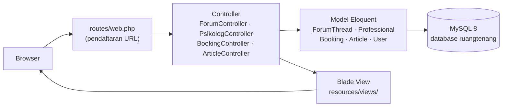
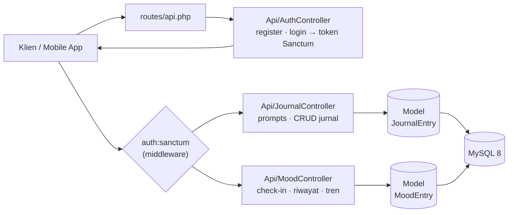
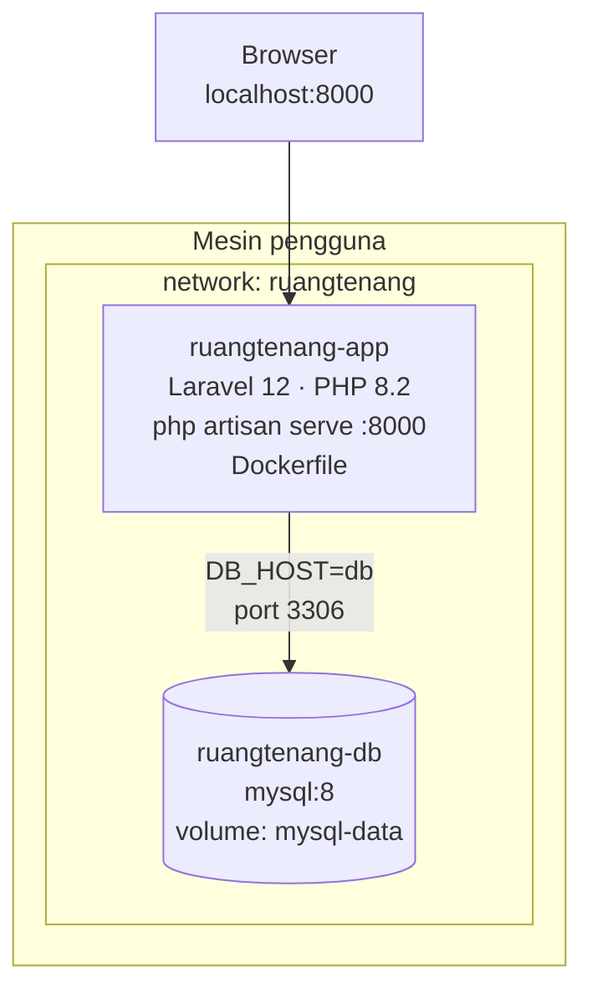

# Arsitektur RuangTenang

Gambaran bagaimana RuangTenang disusun — dari klik di browser sampai data tersimpan di database. Diagram-diagram di bawah ini disusun langsung dari kode sumber (bukan tebakan): setiap panah bisa dilacak ke file yang sesungguhnya.

> **Basis bukti** (rev `9b3dcb0`): `routes/web.php`, `routes/api.php`, `app/Http/Controllers/` (+ `Api/`), `app/Models/`, `docker-compose.yml`, `Dockerfile`, `resources/views/`.
> Catatan: route Day-3 (`/artikel`, `/booking/{id}/batal`, `/booking/{id}/ubah-jadwal`) sudah terdaftar di `routes/web.php` (working tree), sementara controller-nya masih dalam pengerjaan — diagram mencerminkan route yang terdaftar.

---

## 1. Alur Request Web

Permintaan halaman web biasa: browser → route → controller → (model → MySQL) → Blade view.

**Penjelasan:** Setiap URL web didaftarkan di `routes/web.php` lalu ditangani controller yang mengambil data lewat model Eloquent dan menampilkannya dengan template Blade. Halaman statis sederhana (`/`, `/jurnal`, `/mood`, `/masuk`) disajikan langsung via `Route::view` tanpa controller. Alur ini murni server-side — Alpine.js hanya dipakai untuk interaksi kecil di sisi klien.

---

## 2. API dengan Autentikasi Sanctum

API REST untuk jurnal dan mood, diamankan dengan token Laravel Sanctum — dirancang agar aplikasi mobile bisa memakai backend yang sama.

**Penjelasan:** Klien mendaftar/masuk lewat `AuthController` dan menerima token Sanctum; setiap request berikutnya menyertakan token tersebut agar lolos middleware `auth:sanctum`. `JournalController` menyediakan 12 prompt refleksi berbahasa Indonesia plus CRUD entri jurnal milik pengguna, sedangkan `MoodController` mencatat check-in harian (satu hari satu entri) dan menghitung tren rata-rata mood. Semua data terisolasi per pengguna lewat relasi `user_id`.

---

## 3. Layanan Docker (Self-Hosted)

RuangTenang berjalan sebagai dua container di mesin pengguna sendiri — tidak ada komponen cloud.

**Penjelasan:** Service `app` dibangun dari `Dockerfile` dan menyajikan HTTP langsung lewat `php artisan serve` di port 8000 (praktis untuk self-hosted; untuk produksi serius bisa diganti nginx + php-fpm). Service `db` memakai image resmi `mysql:8` dengan data tersimpan di volume `mysql-data` agar tidak hilang saat container di-restart. Aplikasi menjangkau database lewat hostname `db` di network internal `ruangtenang`, dan `depends_on` memastikan `app` baru start setelah `db` berstatus healthy.

---

## Ringkasan Komponen

| Komponen | Peran | Sumber |
|---|---|---|
| Browser / klien | Antarmuka pengguna & pemanggil API | — |
| `routes/web.php` | Pendaftaran URL halaman web | `routes/web.php` |
| `routes/api.php` | Pendaftaran endpoint API | `routes/api.php` |
| Controller web | Logika halaman: forum, psikolog, booking, artikel | `app/Http/Controllers/*.php` |
| Controller API | Logika API: auth, jurnal, mood | `app/Http/Controllers/Api/*.php` |
| Sanctum | Autentikasi token untuk API | middleware `auth:sanctum` di `routes/api.php` |
| Model Eloquent | Akses data & relasi antar tabel | `app/Models/*.php` |
| Blade views | Template tampilan (Tailwind + Alpine.js) | `resources/views/` |
| MySQL 8 | Penyimpanan persisten (container `ruangtenang-db`) | `docker-compose.yml` |
| Docker Compose | Orkestrasi `app` + `db` di satu mesin | `docker-compose.yml`, `Dockerfile` |

Diagram dibuat dengan disiplin *repository-backed authoring* dari skill **archify**: setiap komponen dan relasi ditelusur dari file sumbernya, dan ketidakpastian (route Day-3 yang controller-nya belum ada) dinyatakan eksplisit di atas.
